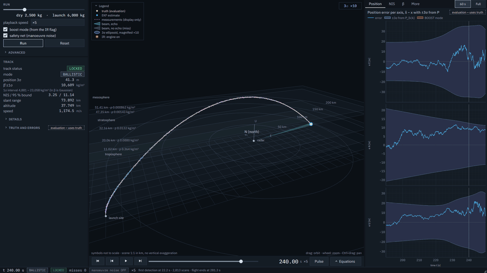
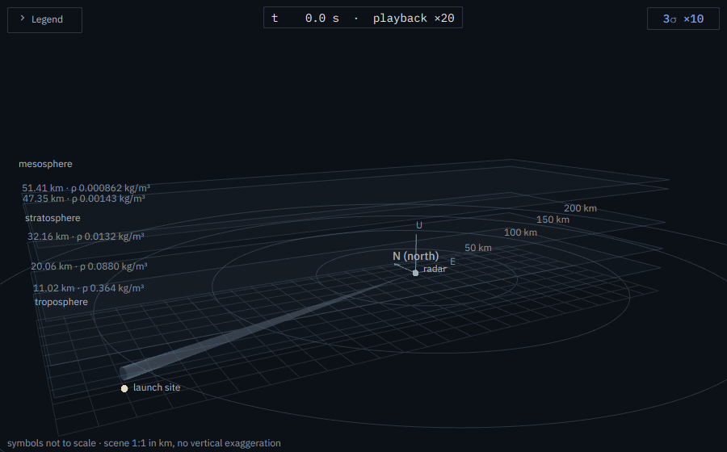
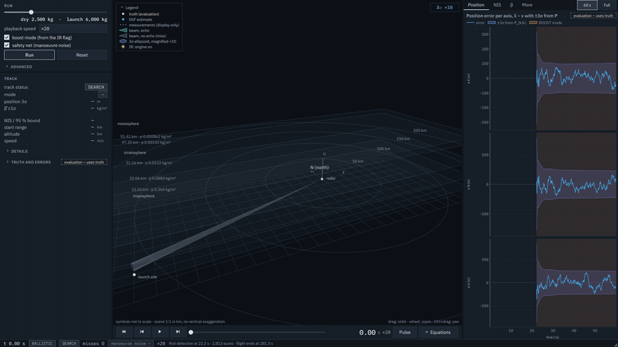
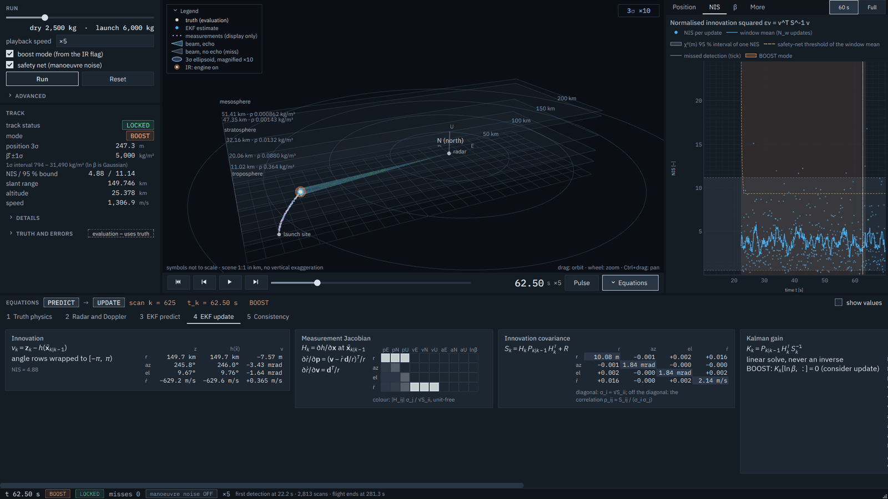
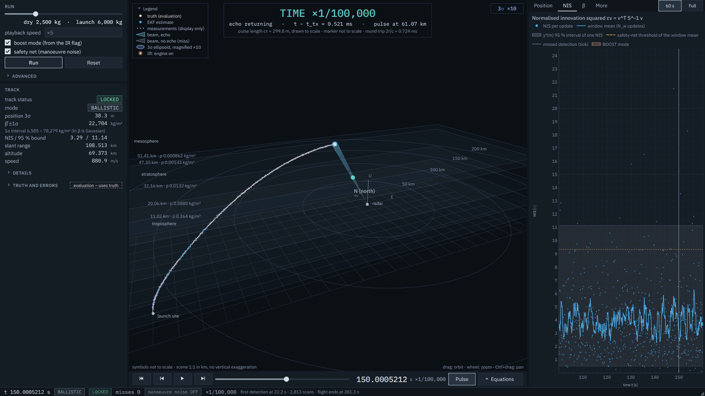

# EKF Ballistic Target Tracker

A radar tracking simulator built to show estimation and signal processing end to end. A 3-DOF physics
model flies a generic ballistic vehicle; a simulated X-band radar measures range, azimuth, elevation and
range-rate; and an Extended Kalman Filter tracks the flight and estimates the ballistic coefficient. A live
3D view, cursor-linked plots and an equations panel show every step of the computation with its numbers.

The vehicle is generic and illustrative. Its parameters are round, generic values, not the data of any
specific system, chosen only so that the flight shows a boost, a coast and an atmospheric re-entry. Nothing
in the project is tuned towards a performance figure; the subject is the tracker.



<sub>The default flight at 240 s, descending towards re-entry. Markers are screen-space symbols, not to
scale; the covariance ellipsoid is magnified by the factor printed in the corner.</sub>



<sub>The 3D view through one full flight, played at ×20 (12 frames per second, every frame at its exact
flight time). The beam starts at the launch-site cue and then follows the filter's prediction.</sub>

## How it works

**Truth physics.** A point-mass model with thrust, propellant burn (decreasing mass), drag with a
Mach-dependent coefficient, inverse-square gravity, and altitude-dependent thrust through the nozzle
exit-pressure term. One atmosphere model, the US Standard Atmosphere 1976 (seven layers, integrated from the
sea-level values), supplies density, pressure and the speed of sound everywhere. Fixed-step RK4 splits the
step exactly at the pitch-program corners and at burnout, and finds ground contact by bisection on the
partial step. The truth ballistic coefficient β = m / (Cd A) changes with time, as both mass and Cd(Mach) do.

**Radar signal model.** The measurement function h(x) gives range, compass azimuth, elevation and
range-rate, with Gaussian noise. The range-rate noise is not a free parameter: it follows from the
wavelength and the dwell time, σ_ṙ = λ / (2 T_dwell) = 1.5 m/s. The beam is a 1.5° cone pointed at the
filter's own prediction; a scan detects only when the target is inside the cone and above the elevation
mask, otherwise it is a miss. Each detection stores its pulse timing (emission time, two-way delay 2r/c,
echo arrival). For information the UI shows the classic pulse-radar trade-off: unambiguous signed Doppler
for this flight needs PRF > 85 kHz, which leaves an unambiguous range of only 1.76 km.

**Extended Kalman Filter.** Ten states, [p, v, a, ln β]. A separate infrared plume sensor reports engine
on/off, and that flag alone sets the mode:

- **BOOST** estimates the unknown thrust acceleration a as a random walk. β is unobservable while the engine
  burns (thrust and drag act along nearly the same line), so its row of the gain is zeroed, a consider update.
- **BALLISTIC** fixes a = 0 and learns ln β.

The flag reports burnout half a second late. At the flag change the filter restores its state from a scan
before the true burnout and re-processes the buffered measurements in BALLISTIC mode, which removes the
thrust it integrated during the latency.

The rest of the filter:

- the Jacobians are analytic and checked against finite differences;
- the covariance update uses the Joseph form;
- the angle innovations are wrapped;
- the process-noise levels are derived from steady-state lag theory rather than tuned;
- a two-level safety net switches on extra manoeuvre noise when the windowed NIS leaves its bound, with a
  threshold set by a false-alarm budget of 1 % per flight.

**Desktop UI.** PySide6 and pyqtgraph. A run is computed once in a separate process and then played back at
×0.1 to ×20 at 60 fps. The panels are:

- the 3D view, with the 3σ covariance ellipsoid and the ISA layer boundaries the flight crosses;
- a filter-first readout;
- plots of position error, NIS and β against their ±3σ bands;
- an equations drawer with the live values of every step, the large matrices as unit-free heat maps;
- a slow-motion pulse view, in which one 300 m pulse travels out and back at ×1/100,000 of real time.

Every exaggeration is labelled on screen with its factor, and every view that reads ground truth carries the
tag "evaluation – uses truth".



<sub>A full flight played back at ×20: the 60 s plot window pages with the cursor, so each phase is shown at
its own error scale.</sub>



<sub>The equations drawer at one update. Each card pairs the equations with the live values of the scan under
the cursor; the large matrices are heat maps of a unit-free magnitude, with the exact entry in a tooltip.</sub>



<sub>The pulse view: one 300 m pulse, drawn to scale, on its way back from the target, with time slowed
×1/100,000. Its timing is the stored two-way delay of that detection.</sub>

The derivations behind all of this, step by step, are in [docs/THEORY.md](docs/THEORY.md).

## Evaluation

All numbers come from 100 Monte Carlo runs of the same flight with different noise seeds. They use the true
state, which the tracker never sees. NEES is averaged over the runs and compared with its 100-run χ² bounds.

**The default filter against the earlier design.** "Boost mode off" ignores the plume flag and models the
whole flight as ballistic, as a filter without a thrust model would.

| | Boost mode on (default) | Boost mode off, safety net on | Boost mode off, safety net off |
|---|---|---|---|
| Runs lost | 0 | 0 | 100 |
| ANEES in the ballistic phase: inside / above / below | 41.9 / 0.1 / 58.0 % | 0 / 100 / 0 % | 0 / 100 / 0 % |
| ANEES in the re-entry: inside / above / below | 94.4 / 0 / 5.6 % | 0 / 100 / 0 % | 0 / 100 / 0 % |
| ANIS in the ballistic phase, inside | 94.7 % | 53.7 % | — |
| Position RMSE, ballistic median / end of flight | 15.1 / 9.3 m | 81.5 / 49.0 m | diverged |
| Velocity RMSE, ballistic median | 0.68 m/s | 3.19 m/s | diverged |
| RMS ln β error, start of re-entry / end | 0.43 / 0.069 | 2.32 / 0.068 | — |
| Runs in which the safety net switched on | 0 | 100 | — |

With the plume flag and the thrust estimate, the filter is never over-confident for more than 0.1 % of the
ballistic scans, and the safety net stays off. Without them, the safety net is the only thing that keeps the
track, and the filter is over-confident throughout.

**Mass sweep.** The same filter settings for every vehicle mass (no per-mass tuning).

| Dry mass | ANEES ballistic: inside / above / below | ANEES re-entry: inside / above / below | Lost | Position RMSE (median) |
|---|---|---|---|---|
| 1,500 kg | 90.0 / 0.1 / 9.8 % | 82.8 / 0 / 17.2 % | 0 | 11.9 m |
| 2,500 kg (default) | 41.9 / 0.1 / 58.0 % | 94.4 / 0 / 5.6 % | 0 | 15.1 m |
| 3,500 kg | 89.8 / 0.0 / 10.2 % | 100 / 0 / 0 % | 0 | 22.1 m |
| 4,500 kg | 86.2 / 0.0 / 13.8 % | 95.5 / 0 / 4.5 % | 0 | 27.3 m |
| 5,500 kg | 79.1 / 0.0 / 20.9 % | 92.7 / 0 / 7.3 % | 0 | 34.5 m |

**Other checks.**

- **Burnout re-processing:** cuts the RMS velocity error just after the flag from 64.7 to 44.0 m/s over 20
  paired runs.
- **Safety-net threshold:** fed with independent χ² values, it fires in 0.59 % of simulated nominal flights
  against its 1 % budget.
- **Track lock:** median 23.2 s after launch, one second after the first detection.

## Repository layout

```
src/ekfsim/              headless core: no Qt, fully testable
  config.py              every parameter, with its unit and origin
  atmosphere.py          US Standard Atmosphere 1976
  aero.py                Cd(Mach) table
  vehicle.py             thrust, mass flow, pitch program, truth equations of motion
  integrators.py         RK4 with exact events and ground contact
  radar.py               h(x) and its Jacobian, noise, Doppler, beam, pulse timing, IR flag
  ekf.py                 filter model, Jacobians, predict/update, modes, safety net, track status
  scenario.py            one run: truth, then radar and filter interleaved
  metrics.py             NIS, NEES, chi2 bounds, RMSE
  montecarlo.py          Monte Carlo command-line runner
src/ekfsim_ui/           the desktop UI (the only package that imports Qt)
tests/                   pytest suite
docs/THEORY.md           the model and the filter, step by step
```

## Getting started

Python 3.12 or newer (developed on 3.12 under Windows 11). The versions in `requirements.txt` are the ones
the tests ran with.

The commands call the Python inside the virtual environment directly, so no activation step is needed.
Windows, cmd or PowerShell:

```bat
git clone https://github.com/Jonathan-Balulu-Christiansen/EKF_Simulation.git
cd EKF_Simulation
python -m venv .venv
.venv\Scripts\python -m pip install -r requirements.txt
.venv\Scripts\python -m pip install -e . --no-deps
```

In Git Bash, write the same path with forward slashes, `.venv/Scripts/python`. On Linux or macOS it is
`.venv/bin/python` (create the environment with `python3 -m venv .venv`). Every command below is written for
cmd and PowerShell.

**Run the app:**

```bat
.venv\Scripts\python -m ekfsim_ui
```

The default scenario runs on launch; press **Run** after changing a parameter. The mass slider, boost mode
and safety net are in the **Run** group, and every other parameter is under **Advanced**. Keys:

| Key | Action |
|---|---|
| Space | play / pause |
| Left / Right | one scan back or forward |
| Home / End | start / end of the flight |
| + / − | playback speed |
| E | equations drawer |
| P | pulse view |
| L | fold or unfold the 3D legend |
| R | reset the camera |
| F11 / Esc | full screen / leave full screen |

**Run the Monte Carlo evaluation** (writes plots, a CSV time series and a JSON summary to `results/` in the
current working directory):

```bat
.venv\Scripts\python -m ekfsim.montecarlo --runs 100 --seed 0
.venv\Scripts\python -m ekfsim.montecarlo --runs 100 --mass-sweep
```

## Tests and code quality

```bat
.venv\Scripts\python -m pytest -q
```

217 tests. The core runs headless, and the UI tests run on Qt's offscreen platform. They cover:

- **Physics and numerics:** the atmosphere reference values, the RK4 order on a smooth case (the error
  ratio per halving is 1/16), energy and mass conservation, exact event splitting.
- **Radar:** h(x) against its inverse, angle wrapping across North, the beam and mask tests.
- **Filter:** the analytic Jacobians against central differences, the EKF reducing to the textbook Kalman
  filter on a linear case, the Joseph update against a Monte Carlo of the update, the derivations of every
  noise level, the false-alarm rate of the safety net, and the effect of burnout re-processing.
- **UI:** contrast and font coverage of the theme, the pulse geometry, the display units, and that a run
  computes without blocking the event loop.

A static test also checks that the filter never imports the truth model. The code passes the
[Ruff](https://docs.astral.sh/ruff/) linter with its default rules and the line length set in `pyproject.toml`
(`ruff check .`).

Every function documents its equations in plain text, one per line, followed by the name of the quantity.
Comments cite the sections of [docs/THEORY.md](docs/THEORY.md) as `(THEORY 6.3)`.

## Design decisions

- **Truth is for evaluation only.** The tracker never reads it: not for the beam pointing, the track status,
  the noise adaptation or the initialisation. Only the measurement generator and the views tagged
  "evaluation – uses truth" do.
- **No inverse crime.** The filter shares the atmosphere with the truth, but assumes a constant β (the truth
  has Cd(Mach) and a changing mass) and estimates the thrust instead of modelling it.
- **ln β, not β.** It keeps β positive and makes a parameter that spans two decades well conditioned.
- **Derived, not tuned.** The process noise comes from steady-state lag theory with one margin rule (lag at
  most half the parameter's own σ) over the whole mass range. The safety-net level is the largest
  acceleration the class can have unmodelled; its threshold comes from a per-flight false-alarm budget.
- **Joseph form.** It keeps P symmetric and positive definite, and stays exact for the non-optimal gain of
  the frozen ln β row.
- **Compute, then play back.** The filter is strictly causal; precomputing only makes pause, scrub and slow
  motion trivial and deterministic.

## Known limitations

- **Conservative coast at the default mass.** ln β is a random walk with a constant rate, while its true
  rate of change follows the deceleration. In a long coast in thin air, drag is too weak to inform β but
  not zero, so σ(ln β) grows and reaches the along-track velocity. The ballistic ANEES then sits about 15 %
  below its ideal value (58 % of the scans below the bound). A rate scheduled on the filter's own
  deceleration estimate would address it.
- **Boost noise set by the lightest vehicle.** q_thrust covers the steepest thrust ramp of the mass range,
  so heavier vehicles are conservative in boost.
- **ln β collapse at the switch in 5 of 100 runs.** When drag first becomes informative, the EKF linearises
  exp(−ln β) at the current estimate. Noise that asks for more drag can shrink σ(ln β) onto a wrong value for
  a few seconds. A filter that does not linearise this term, such as a UKF, would address it.
- **Safety-net budget.** It is set for one nominal flight length, so longer flights see a slightly higher
  false-alarm rate. The higher threshold also reacts later to a real unmodelled acceleration.
- **Latency scans.** The records of the half second between burnout and the flag keep what a causal filter
  reported at the time; re-processing corrects the state from the flag on.
- **Weak early observability.** The vertical thrust component is poorly observed at low elevation right after
  the first detection.
- **Model limits.**
  - Flat Earth: the real surface drops about d²/(2R), 3 km at 200 km.
  - 3-DOF point mass.
  - An estimated Cd table and nozzle exit area.
  - Unambiguous Doppler is assumed.
  - No clutter, no false alarms, detection probability 1.

An interacting multiple-model filter or an explicit burnout-time model would address the mode-switch
transient more directly than re-processing.

## References

- G. P. Sutton, O. Biblarz, *Rocket Propulsion Elements*: the thrust equation with exit pressure,
  specific impulse, mass flow.
- U.S. Standard Atmosphere, 1976 (NOAA, NASA, USAF).
- Y. Bar-Shalom, X. R. Li, T. Kirubarajan, *Estimation with Applications to Tracking and Navigation*,
  Wiley, 2001: NEES/NIS consistency tests, adjustable process noise.

## License

[MIT](LICENSE)

IBM Plex fonts: SIL Open Font License 1.1, see
[src/ekfsim_ui/assets/fonts/OFL.txt](src/ekfsim_ui/assets/fonts/OFL.txt).
